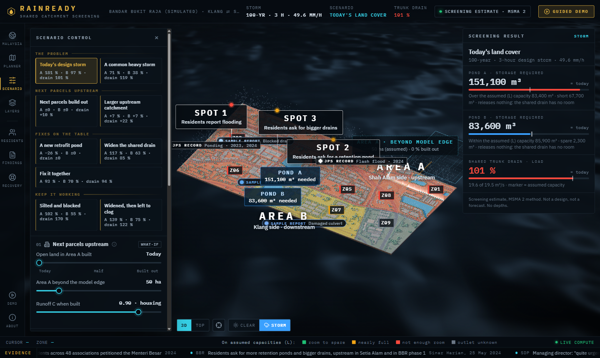
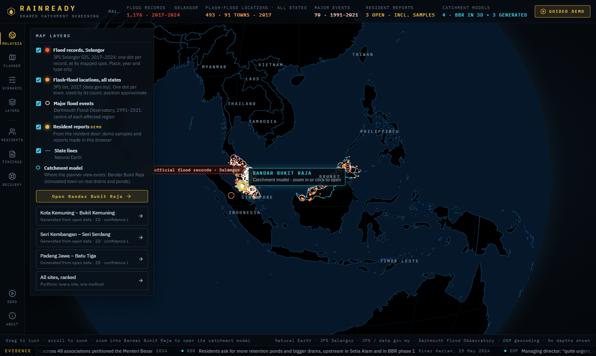
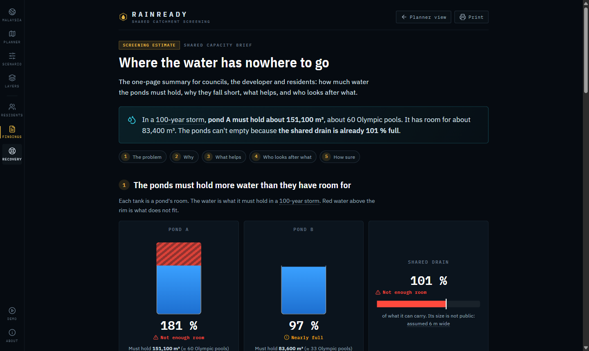
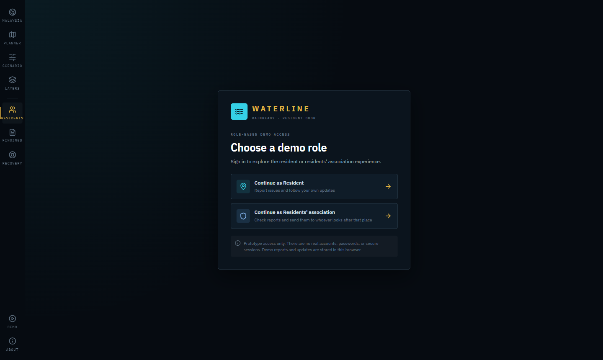
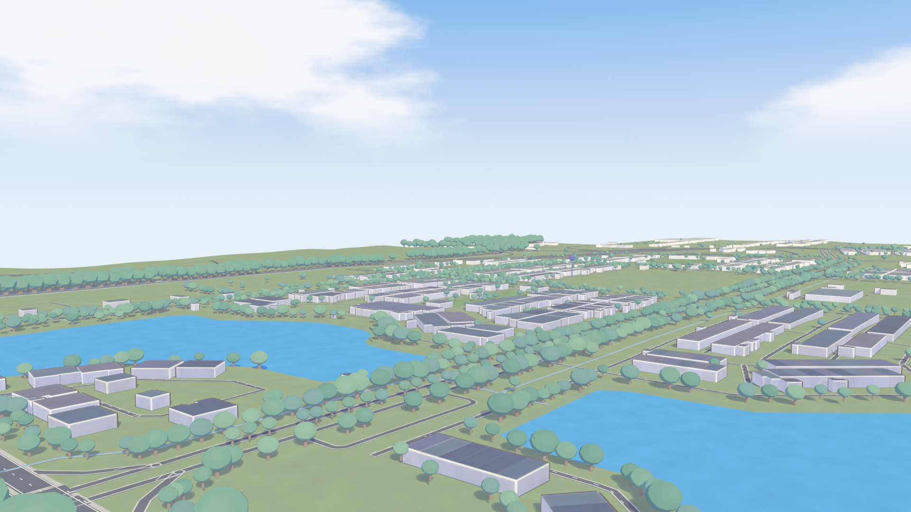

# RainReady

**Property lines stop at the fence. Water doesn't.**

[](LICENSE)
[](https://rainready-wheat.vercel.app)


RainReady is one shared picture of how water moves across council and developer boundaries. It has two doors:
**planners** see where storage falls short, and **residents** act in time, with their reports shaping the next plan.

Sime Darby Property University Hackathon 2026 · *Township of Tomorrow* · Theme: Planet (climate resilience)

| | |
|---|---|
| **Live prototype** | https://rainready-wheat.vercel.app |
| **Website source** | [LemonAidLee/rainready-website](https://github.com/LemonAidLee/rainready-website) |
| **Reference site** | Bandar Bukit Raja (BBR), Klang, with Setia Alam upstream in Shah Alam |



## The problem

Residents of Bandar Bukit Raja report that Jalan Makyong floods at least three times a year, and about 583 residents
across 48 associations petitioned the Menteri Besar in 2024. Water flows from Setia Alam (Shah Alam) into BBR (Klang),
across different councils and developers. Many programmes already exist (new ponds, drain works, a joint Selangor and
Federal Territories strategy), but they run separately and nobody holds one shared picture of capacity.

RainReady does not claim nothing is being done. It claims the programmes need a common view of where the water goes and
where storage runs short. Sources are in [documentation/supporting/BBR_PUBLIC_DOCUMENT_SURVEY.md](documentation/supporting/BBR_PUBLIC_DOCUMENT_SURVEY.md).

## What it does

**Planner door**
- Catchment view of a simulated township, loosely based on BBR, with the council boundary and the shared drain.
- Rain and upstream scenarios: a design storm, a common heavy storm, and what happens when upstream parcels are built out.
- Pond what-if and a before-you-build check.
- A one-page **Shared Capacity Brief** for councils, the developer and residents.

**Resident door (Waterline)**
- Report and track an issue through existing messaging.
- A move-now plan that builds on official warnings and links back to them. It is advisory, not a forecast.

**Both doors:** a responsibility record of who looks after which pond and drain under the official rules.

| Malaysia, then the catchment | Shared Capacity Brief |
|---|---|
|  |  |

| Resident door (Waterline) | The simulated township in 3D |
|---|---|
|  |  |

## How the numbers are made

- A 3D township built in Blender, loosely based on BBR, with real drains and ponds from OpenStreetMap and terrain from
  Copernicus DEM.
- A screening simulator using the **MSMA 2nd Edition** method (DID Malaysia, 2012) on sourced inputs. It estimates storage
  required, pond load and shared-drain load.
- A general drain-network engine, so the same method runs on other townships. Three more sites are generated from open
  data.

## Design principles

- **Decision support under uncertainty, not prediction.** The terrain error is about 1 m in built-up areas, so the
  product shows risk bands and scenarios, never a predicted flood depth.
- **Advisory, not forecast.** Alerts build on official MET Malaysia and drainage department warnings.
- **Neutral by design.** It shows flow paths and capacity. It does not assign blame to a developer, a council or residents.
- **Honest about limits.** Assumed values are marked as assumed, and confidence is labelled H, M or L.
- Developer booklet figures are design values, not as-built.

## Repository layout

| Folder | What is in it |
|---|---|
| [documentation/RAINREADY_CONCEPT_V2.md](documentation/RAINREADY_CONCEPT_V2.md) | The concept: problem, users, two doors, features |
| [documentation/TOWNSHIP_3D_AND_SIMULATOR.md](documentation/TOWNSHIP_3D_AND_SIMULATOR.md) | How the 3D township and the screening simulator are built |
| [documentation/PLATFORM.md](documentation/PLATFORM.md) | The platform: any township as a site pack |
| [documentation/WEBSITE.md](documentation/WEBSITE.md) | The website: screens and design |
| [documentation/RESIDENT_PLANNER_INTEGRATION.md](documentation/RESIDENT_PLANNER_INTEGRATION.md) | How resident reports become pins in the planner view |
| [documentation/supporting/](documentation/supporting/) | Competition brief, problem validation, gap analysis, public evidence, feasibility |
| [research/](research/README.md) | Research findings, one file per question, and how every open item was settled |
| [simulations/township-3d/](simulations/township-3d/) | The Blender township, build scripts and the screening simulator (`screening.py`, `inputs.json`) |
| [simulations/platform/](simulations/platform/) | The drain-network engine, site builder and generated sites |
| [simulations/rainready-playground/](simulations/rainready-playground/) | A 2D teaching model with invented terrain and illustrative numbers |
| [presentation/](presentation/README.md) | Animated HTML presentation used for the video |

## Getting started

Run the screening simulator (Python 3, no Blender needed):

```
cd simulations/township-3d
python screening.py
```

The website is in its own repository, [rainready-website](https://github.com/LemonAidLee/rainready-website): `npm install`, then `npm run dev`.

## Status

A working prototype built for the Sime Darby Property University Hackathon 2026. The 3D township is simulated, the numbers
are screening estimates, and several inputs are stated assumptions (marked as such in `research/`).

## Licence and data

Code and documentation are released under the [MIT licence](LICENSE). Third-party data keeps its own licences:

Map data © OpenStreetMap contributors (ODbL). Terrain: Copernicus DEM GLO-30 © DLR e.V. 2010–2014 and © Airbus Defence
and Space GmbH, provided under COPERNICUS by the European Union and ESA. Flood records from JPS Selangor GIS, data.gov.my
and the Dartmouth Flood Observatory.

*RainReady is a screening tool. It is not a flood forecast and not an engineering design.*
